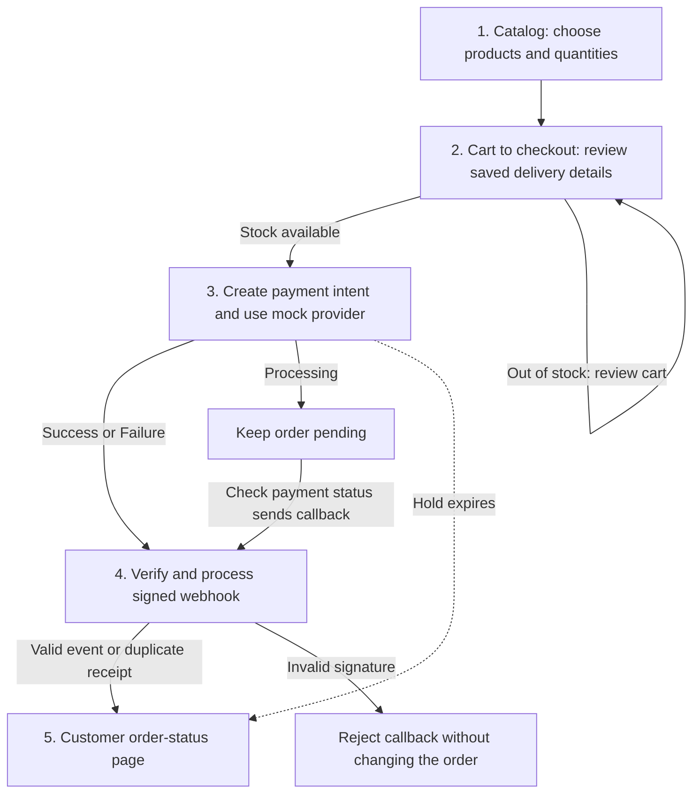
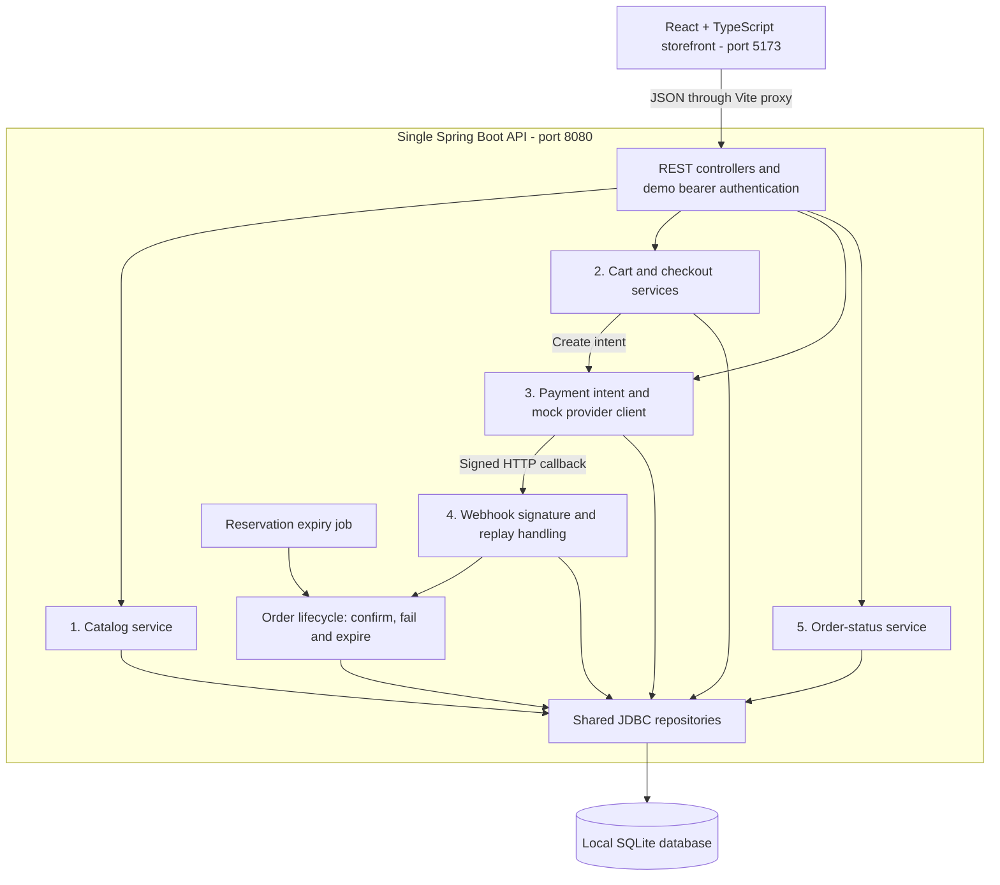
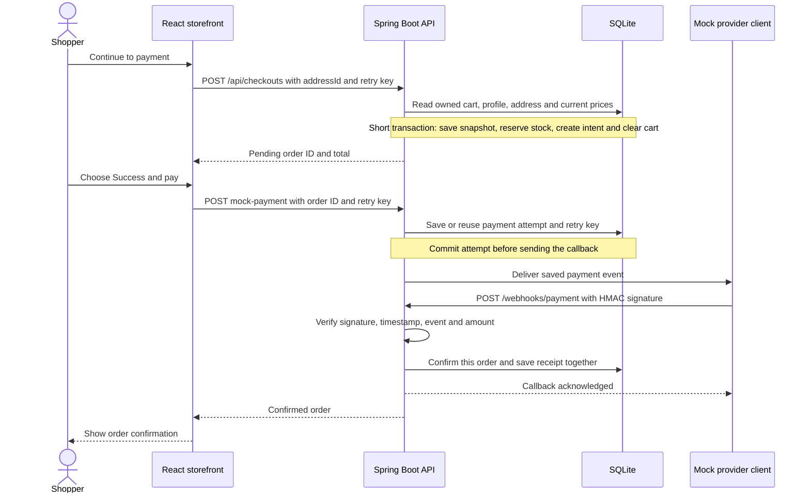
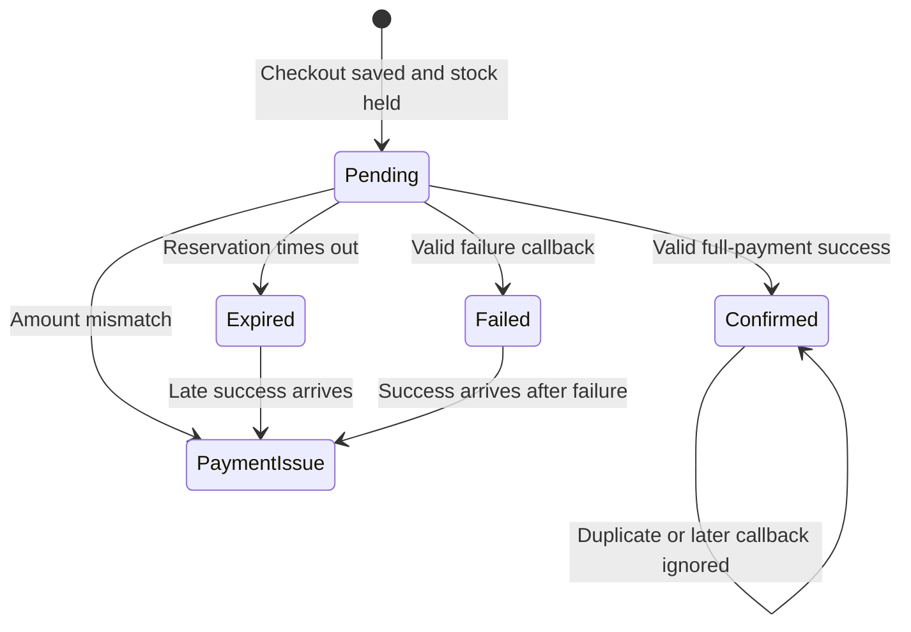

# KINETIC - Architecture and presentation guide

A small D2C checkout: five products, a saved cart, delivery details, mocked payment, and order tracking. This guide follows the assignment's five subtasks. Setup instructions and design decisions remain in the original [README](README.md).

## The five subtasks

| # | Assignment subtask | What happens in this app |
|---|---|---|
| 1 | Catalog of about five SKUs | Show five products with price, availability and quantity controls. |
| 2 | Cart to checkout | Load the shopper's cart, profile and selected address on the server; calculate the total, save the order snapshot, reserve stock and clear the active cart when continuing to payment. |
| 3 | Payment intent with a mocked provider | Save the expected amount and currency, then simulate Success, Failure or Processing. |
| 4 | Webhook that confirms the order | Verify the signed callback, check the amount and handle duplicate events safely before changing order status. |
| 5 | Customer order-status page | Show the shopper's orders and their saved payment status; allow returning to a pending payment. |

## Checkout flow

The order and payment intent are created together when the shopper continues to payment. The order keeps its own copy of the items, prices and delivery details, and the active cart is cleared. The shopper can immediately build a new cart and place another order. Stock is held separately for each order for 15 minutes. Adding something to the cart does not reserve it. The browser displays saved order status; a verified webhook confirms payment.

## High-level design

Everything runs locally: one React app, one Spring Boot API and one SQLite file. The numbered backend components represent the five assignment subtasks, not separate deployed services.

- **Frontend:** pages for catalog, cart, checkout, payment, orders and profile. Shared components handle forms, totals, loading and errors.
- **Controllers:** validate HTTP input and identify the demo shopper. Order, cart and profile access is scoped to that shopper.
- **Services:** own pricing, reservation rules, payment retries, order transitions and transactions.
- **Repositories:** execute parameterized SQL and map database records.
- **Webhook:** uses HMAC and timestamp checks instead of the shopper's bearer token. The mock provider client sends this callback through real HTTP inside the local backend.

## Successful checkout: request sequence

With **Processing**, the provider event is saved but not delivered yet. The demo's **Check payment status** action delivers that saved callback. The order-status screen also polls the order API while waiting. Every started payment shows Processing on return, even if its Success or Failure callback was delayed. Only an order with no payment attempt offers Continue to payment.

## Order states

| State | Stock and cart behavior |
|---|---|
| Pending | Stock is held for this order. The shopper can change their new cart and place another order. |
| Confirmed | Consume the existing hold without deducting stock again. Leave the current cart untouched. |
| Failed | Release the hold once. Keep this order snapshot; items can be copied back explicitly. |
| Expired | Release the hold once. Keep the order snapshot and leave the new cart alone. |
| Payment issue | Release any remaining hold and leave the new cart alone. The demo records the issue; it has no support/refund workflow. |

## The edge case to demonstrate: two shoppers want the last item

1. Both shoppers can add the last mat to their carts. Stock is still available because carts do not reserve it.
2. Both continue to payment. A short SQLite write transaction and conditional stock update allow one reservation to succeed.
3. The winner receives a pending order. The other shopper receives an out-of-stock response; no order or payment intent is created for them.
4. If the winner's payment fails or the hold expires, stock becomes available again. The other shopper can retry.

The database lock lasts only for the checkout transaction. The saved reservation lasts 15 minutes. See [CheckoutServiceImpl](apps/api/src/main/java/com/kinetic/checkout/service/impl/CheckoutServiceImpl.java), [CatalogRepository](apps/api/src/main/java/com/kinetic/checkout/repository/CatalogRepository.java) and the `twoBuyersRaceForLastUnitOnlyOneWins` test in [CheckoutFlowTest](apps/api/src/test/java/com/kinetic/checkout/CheckoutFlowTest.java).

## What the references mean

| Reference | Simple meaning |
|---|---|
| SKU | The product code, such as `TRAINING-MAT`. |
| Order ID | The shopper's purchase reference, shown in My orders. |
| Payment intent ID | The internal reference for the amount and currency expected for that order. |
| Event ID | The provider's callback reference, used to recognise repeated delivery. |
| Idempotency key | A request reference that makes retrying the same action safe. Every accepted payment key stays tied to its original order and outcome. |

## Three decisions to explain

- **An independent snapshot for each checkout:** clears the shopping cart after saving the order, so processing payments do not block browsing, adding products or creating another order. Callbacks never modify a later cart.
- **Webhook confirmation:** the backend trusts the verified provider message. The browser reads the saved result, including after a reload or lost response.
- **SQLite for this assignment:** simple local setup and real transactions. The short write lock handles the demonstrated stock race; a production database choice would depend on traffic and concurrency needs.

## Useful API entry points

| Subtask | Main endpoints |
|---|---|
| 1. Catalog | `GET /api/products` |
| 2. Cart to checkout | `GET /api/cart`, `PUT /api/cart/items/{sku}`, `POST /api/checkouts`, `PUT /api/cart/from-orders/{orderId}` |
| 3. Mock payment | `POST /api/orders/{id}/mock-payment`, `POST /api/orders/{id}/mock-payment/complete` |
| 4. Webhook | `POST /webhooks/payment` |
| 5. Order status | `GET /api/orders`, `GET /api/orders/{id}` |

The checkout endpoint also creates the payment intent. There is no separate public intent-creation endpoint. Profile and address endpoints support subtask 2. All payments are mocked; no real money moves.
