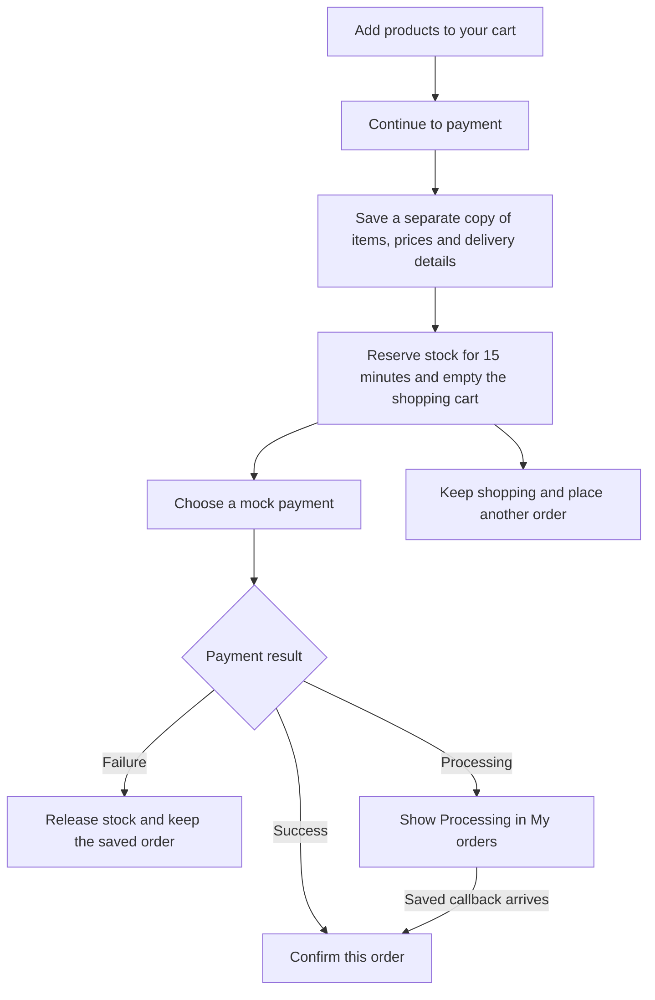
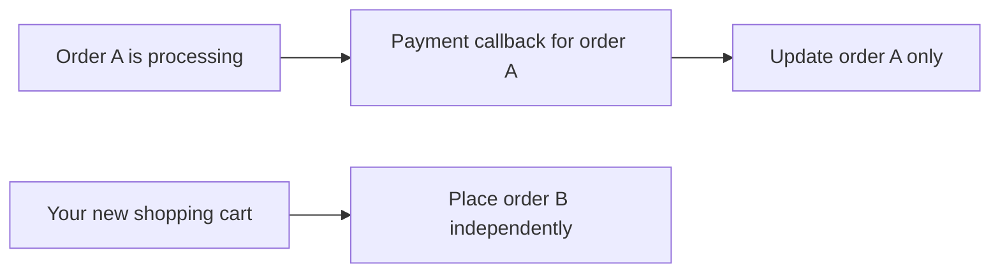

# KINETIC — D2C checkout slice

Five fitness essentials, cart, saved delivery details, mocked payment, signed webhook confirmation, and My orders. Built with **Java 21 / Spring Boot, SQLite / JDBC, and React / TypeScript / Vite**. Runs locally; no payment account or database server needed.

## Run

Requirements: Java 21 and Node.js 22.12+. First startup downloads dependencies.

Open two terminals at the repository root:

```sh
# Terminal 1 — API
cd apps/api
sh mvnw spring-boot:run
```

```sh
# Terminal 2 — storefront
cd apps/web
npm ci
npm run dev
```

Open **http://127.0.0.1:5173**. The API listens on `127.0.0.1:8080`; Vite proxies requests. On Windows, use `mvnw.cmd` instead of `sh mvnw`. Stop each process with Ctrl+C. Restart the API after changing Java code.

### Try the flow

1. Add products; use **− / quantity / +** on the catalog or cart.
2. Review checkout. Edit your contact details or add, edit and remove saved addresses.
3. **Continue to payment** reserves the items for 15 minutes.
4. Choose **Success**, **Failure**, or **Processing**, then pay the displayed full amount. Every order includes a visible **₹29 packing & handling fee**; delivery is included.
5. Success confirms the order through the webhook. Failure releases its reserved stock; use **Add these items to cart** on the saved order to try again. Processing shows a loader and stays pending; **Check payment status** delivers the saved callback in this demo. You can keep shopping and place another order while it waits. My orders lets you return later.

The bundled token `demo-customer-1` identifies the seeded shopper. Checkout accepts only `addressId`; the server loads that user's cart, profile, address and current prices. There is no real login or money movement.

## How the checkout works



A saved order is the durable copy of that checkout. It is stored in SQLite, so it survives a page refresh or API restart. Your current cart is free for your next purchase. The old order's payment confirmation, failure or expiry never clears or restores items in that new cart.



**Returning to an order:** a started payment shows **Processing** and **View payment status**. It does not ask you to pay again. An order whose payment was never started can still show **Continue to payment**. The 15-minute hold can expire in either case.

**Trying again after failure or expiry:** choose **Add these items to cart** on that order. This copies its products into your current cart, checks today's stock and prices, and keeps other items already there. Repeating the action does not increase quantities again; a higher quantity already in the cart is kept. Nothing is restored automatically.

See [README-HLD.md](README-HLD.md) for the five assignment subtasks, architecture, request sequence and order-state diagrams.

## Structure

```text
apps/api/
  src/main/java/com/kinetic/checkout/
    controller/       HTTP endpoints and validation
    dto/              request and response contracts
    service/          business contracts
      impl/           transactional business rules
    repository/       parameterized SQL and row mapping
    model/            stored domain records and order states
    security/         demo identity and HMAC verification
    client/           mock provider's HTTP webhook delivery
    config/           SQLite setup and schema upgrades
    scheduler/        expired reservation cleanup
    exception/        consistent API errors
    util/             money rounding and retry-key validation
  src/main/resources/db/  readable schema and seed SQL
  src/test/                HTTP integration and money tests
  sample/                  clean, committed SQLite database
apps/web/src/
  pages/              catalog, cart, checkout, payment, orders, profile
  components/         shared UI; profile forms shared by two pages
  context/            cart and profile state
  hooks/              reusable asynchronous loading
  services/           typed HTTP client
  types/              API types
  utils/              formatting and stable retry keys
```

Controllers call service interfaces; implementations own transactions and use repositories. Repositories are concrete JDBC classes, without a generic base abstraction. Frontend tests sit beside their pages/client. Comments explain transaction boundaries and retry behavior where those choices matter.

The sample database contains five products, one demo profile, two addresses and no orders. First run copies it to the ignored `apps/api/data/checkout.sqlite`; subsequent runs preserve your data. Older databases upgrade automatically, keeping existing orders and their original payment keys. Missing sample files fall back to schema/seed SQL. To start another clean demo without replacing existing data, run `CHECKOUT_DB=data/fresh-demo.sqlite sh mvnw spring-boot:run` from `apps/api` after stopping the current API.

## Tests

```sh
# From apps/api
sh mvnw test

# From apps/web
npm test
npm run build
npm run format:check
```

Verified: **33 backend tests, 30 frontend tests, production build and formatting check**. Integration tests use temporary SQLite databases and actual HTTP requests, including the provider-to-webhook call. They cover ownership, strict input validation, retries, signatures, replay, amount mismatch, expiry, stock races and transaction rollback. Rollback and payment-recovery tests deliberately force database errors and expect HTTP 503; those error logs are intentional. Regressions also cover multiple orders for one shopper, a late callback leaving the new cart untouched, safe item copying, correct Processing actions, overlapping cart refreshes, lost checkout responses, payment key reuse and database upgrades.

### Demonstrate the stock race

From `apps/api`:

```sh
sh mvnw '-Dtest=CheckoutFlowTest#twoBuyersRaceForLastUnitOnlyOneWins' test
```

The test prints four steps: both buyers add the last unit without reserving it; concurrent checkout requests produce **201 + 409**; a failed payment releases the winner's hold; the other buyer retries and confirms. It uses an isolated database and does not modify your running demo.

## Design decisions

### Three tradeoffs I chose

1. **Reuse the same key when a request is retried.** The browser gives each checkout or payment action a random UUID and keeps it if the response is lost. The server uses that key to return the same result instead of creating another order or payment. Disabling the button alone would be simpler, but it would not protect against a network retry or a repeated API request. Every accepted payment key is saved against the original attempt. A retry from another browser can use a fresh key for that same payment; both keys stay tied to that order and outcome.

2. **Keep each order separate from the shopping cart.** Checkout saves the items, prices and address, then clears the cart. The shopper can build another cart and place another order while an earlier payment is processing. I rejected blocking the cart until payment finishes because a slow payment should not stop shopping. Each order has its own stock hold and payment attempt. Old callbacks update only that order. Failed or expired items can be copied back explicitly, so they do not unexpectedly appear in a new cart.

3. **Confirm payment through the webhook.** The payment provider sends a signed message to the backend, and only that message can confirm the order. The browser checks the saved order status to show the result. Trusting the payment screen would be easier, but a shopper could close it or change what it sends. Repeatedly asking the provider for every payment result would add more work to this small demo. The Processing option has one demo shortcut: checking its status releases the saved callback.

### One failure I handled: two shoppers want the last item

Both shoppers can add the last mat to their carts. When they continue to payment, only one gets it. A short SQLite write lock and a stock check protect the reservation. The other shopper sees an out-of-stock message, with no order or payment created. If the first payment fails or the hold expires, the item becomes available again. The database lock lasts only while saving the checkout; the saved reservation lasts 15 minutes.

The code is in [CheckoutServiceImpl.create](apps/api/src/main/java/com/kinetic/checkout/service/impl/CheckoutServiceImpl.java), with the stock check in [CatalogRepository.reserve](apps/api/src/main/java/com/kinetic/checkout/repository/CatalogRepository.java) and locking configured in [DatabaseConfig](apps/api/src/main/java/com/kinetic/checkout/config/DatabaseConfig.java). The test `twoBuyersRaceForLastUnitOnlyOneWins` in [CheckoutFlowTest](apps/api/src/test/java/com/kinetic/checkout/CheckoutFlowTest.java) sends both requests together and checks that only one succeeds. It also checks that the second shopper can retry after the first payment fails.

### What I changed after the first pass

I changed checkout to load the shopper’s saved cart, profile and address on the server. The browser now sends only the selected address ID. I made the product cards smaller, added quantity controls, and let shoppers edit their profile and addresses. I added recovery for a lost checkout response: the page links to the saved order even if refreshing the cart fails. I also made cart refreshes ignore results that arrive after a quantity update finishes. After interview feedback, I removed the cart lock and the one-pending-order restriction. Checkout now saves its own snapshot and clears the cart immediately. I also made every started payment show Processing on return, including a delayed callback from a Success or Failure scenario. I reduced the payment choices to Success, Failure and Processing, with a loader while waiting. I removed the partial-payment and double-click controls from the screen, but kept the backend checks for those cases. I also separated the backend into controllers, services and repositories, and grouped the frontend by page. With more time, I would add checkout cancellation and automate the browser journeys I tested manually.

### What I would do in week two

My first priorities would be real login and a real payment provider. I would add a background job to retry missed payment messages and check payments that stay pending too long. There would also need to be a way for support to investigate payment issues and issue refunds. I would use decimal values for stored money, add alerts for failed payments and stock problems, and test the checkout on more browsers and phones. I would decide whether to move from SQLite to a separate database based on expected traffic.

## Scope

All payment credentials are explicit demo values. Tracking covers payment/order status, not shipment fulfillment. My orders shows the latest 100 orders. No admin, tax engine, hosting or optional agent-retry schema is included. AI tools assisted implementation and verification.
